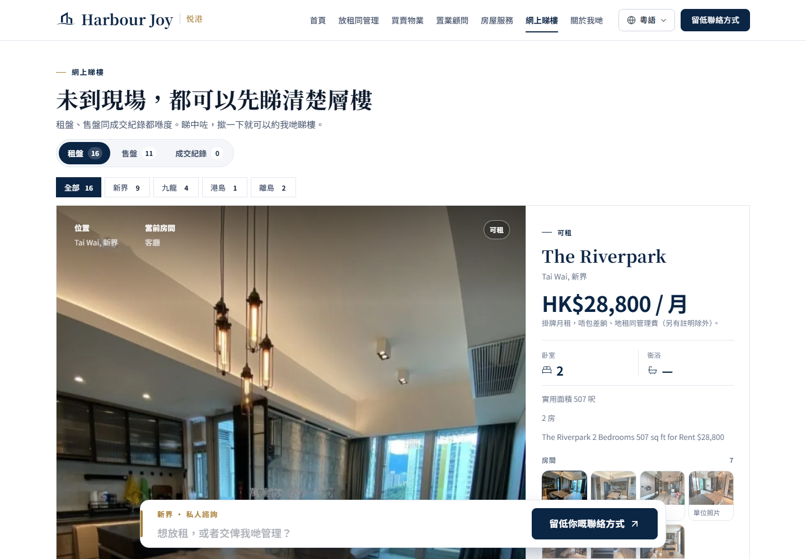

# 自家盘源接入「网上睇楼」

2026-11-09。把 `data/ref/hk-market-listings` 的 **27 条自家委托盘**接进 `/zh/viewings`，
每条 6~8 张房图（客廳 / 睡房 / 廚房 / 浴室 + 單位照片）。



## 一、现在线上有什么

| | 数量 |
| --- | --- |
| 租盤 | 16（新界 9 / 九龍 4 / 離島 2 / 港島 1） |
| 售盤 | 11 |
| 成交紀錄 | 0（`data/ref` 里没有成交记录，空着） |
| 房图 | 172 张，1600w + 600w WebP |

来源与核对日期保留在每条记录里：`sourceName: "28Hse"`、`sourceUrl`、`checkedAt`（发帖日）。
`publicReuseApproved: true` 标记这批盘我们有权公开发布；`demo: false`，页面不再当示范盘。

## 二、数据怎么来的

`scripts/hk-own-listings-import.py`：

```
data/ref/hk-market-listings/
├── 楼盘资料.csv        → 屋苑、地区、房数、呎数、价钱、发帖日、来源页
├── 图片清单.csv        → 哪张图是客厅/卧室/厨房/浴室
├── selected/           → 已按房间分好类的图
└── raw/<rent|sale>-<pid>/  → 该盘原图（不够 8 张时从这里补，标为「單位照片」）
```

重跑一次就覆盖同名盘，不会重复插入：

```powershell
python scripts/hk-own-listings-import.py --ref data\ref\hk-market-listings
```

## 三、水印（已接 LaMa）

图片经过两道处理，最终用的是 **LaMa 生成式修复后的版本**：

1. 先把 `clean/raw/<盘号>/`（原有一版去水印结果）作为基础；
2. 再用 LaMa（big-lama，PyTorch CPU）对残留的淡字做一遍**细笔画修复** —— 只把检测到的
   笔画像素交给模型，模型补完只贴回这些小洞，画面其它部分不动。

模型来源 `simple-lama-inpainting`，权重 `big-lama.pt`（约 196MB）首次运行自动下载到
`~/.cache/torch/hub/checkpoints/`。

### 复跑命令

```powershell
pip install torch torchvision --index-url https://download.pytorch.org/whl/cpu
pip install simple-lama-inpainting

# 只处理这 27 条盘（约 13 分钟 / 196 张，CPU）
python lama_batch.py --src "<clean/raw>" --out "<clean-lama/raw>" --keys rent-4089710,sale-4089729,...

# 再导入
python scripts/hk-own-listings-import.py --ref data\ref\hk-market-listings --clean-sub clean-lama
```

两个脚本在 `scripts/` 下：`lama_batch.py`（批量细笔画收尾）、`lama_dewatermark.py`（单张/小批量，带对照图）。

### 为什么不直接对着原图抹

试过两条路，都有代价：

| 做法 | 结果 |
| --- | --- |
| **固定大框**（中间 46%×25% 整块交给 LaMa） | 水印彻底没了，但模型会**重画整块**：微波炉、灶头、沙发、餐桌都可能被"编"掉或糊掉 |
| **细笔画掩膜**（只喂笔画像素） | 画面结构完整保留，但半透明的淡影只能清掉一部分 |

现在这套是「细笔画 + clean 版打底」，最平衡：**主 logo 和代理行名看不见了**，
极少数图还能在 1:1 放大下看到极淡的一圈印子。

要 100% 干净、且不牺牲画面，只有一条路：给**上传 28Hse 之前的原图**，我重跑一遍导入即可。

## 四、其它改动

| 文件 | 改动 |
| --- | --- |
| `src/viewing-types.ts` | `publicReuseApproved` 从字面量 `false` 放宽成 `boolean`（自家盘要 true） |
| `src/hk-site.ts` | `SHOW_DEMO_LISTINGS` 改为 `false`：之前 20 套示范盘（reference-9000000xxx）不再显示，数据还留着，改回 `true` 就回来 |
| `scripts/hk-own-listings-import.py` | 新的导入脚本 |
| `public/img/hk/listings/<pid>/` | 27 个目录、420 个文件（webp + thumb） |

## 五、验收

```powershell
npm run dev
```

<http://127.0.0.1:5173/zh/viewings>

- 租盘 16 条，点右侧「房間」切客厅/睡房/厨房/浴室/單位照片
- 售盘 11 条，价格显示为叫价
- `?kind=sale` 直达售盘

`npm run build` 会连 `tsc --noEmit` 一起跑，改了 `viewing-types.ts` 记得跑一次。

## 六、还能补的

`raw/` 里还有 32 个盘号不在 `楼盘资料.csv`（旧批次抓的），要的话把那批也补进 CSV，
重跑导入脚本就是 59 条盘。
